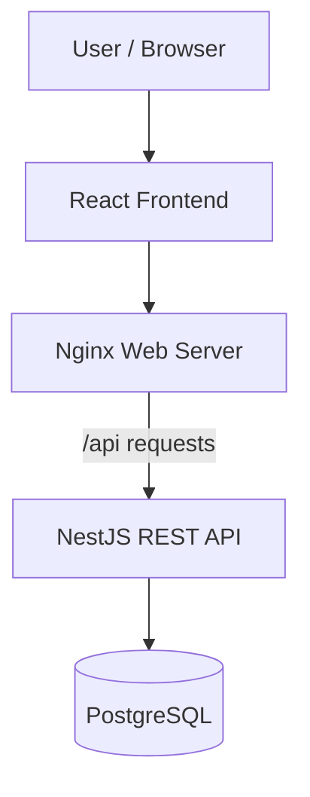
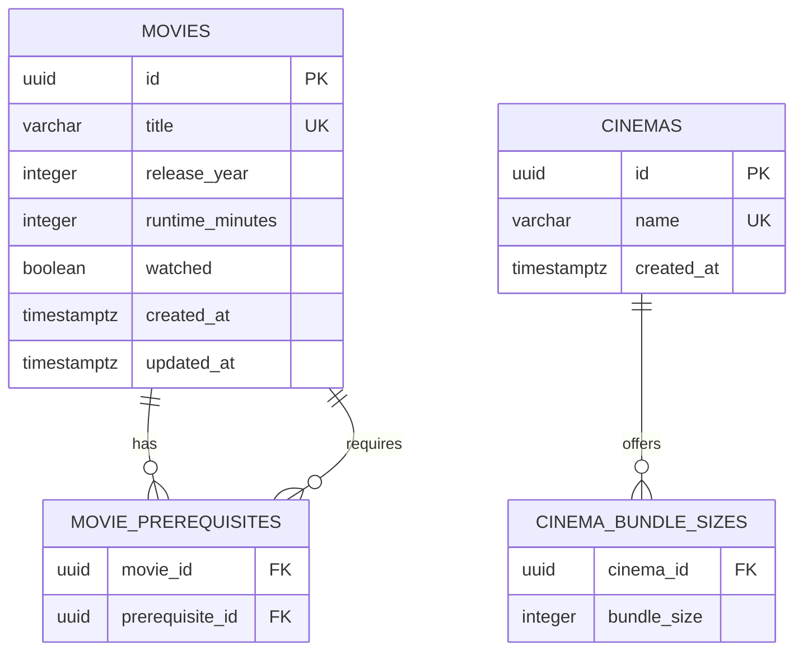

# Doomsday Ready

**A full-stack MCU rewatch planner and watch-party booking application.**

Doomsday Ready helps users prepare for the next Avengers movie by organizing prerequisite movies into a valid rewatch order, tracking watched progress, and calculating the most efficient cinema bundle combinations for a watch party.

## Features

### 1. Movie Management

- Add movies with a title, release year, and runtime.
- Define prerequisite movies.
- Edit movie information and prerequisite relationships.
- Track watched status.
- Validate movie dependencies and reject circular dependencies.

### 2. Rewatch Planner

- Select a target movie.
- Automatically include all its transitive prerequisites.
- Display prerequisites in a valid topological order.
- Include each prerequisite exactly once.
- Track watched movies and calculate remaining unwatched runtime.

### 3. Cinema Watch-Party Booking

- Create cinemas with supported seat-bundle sizes.
- Enter a group size between 1 and 10,000.
- Calculate the minimum number of bundles required to accommodate the group exactly.
- Display the number of bundles needed for each size.
- Report when an exact booking combination is impossible.

## Technology Stack

| Layer           | Technology                             |
| --------------- | -------------------------------------- |
| Frontend        | React, TypeScript, Vite                |
| Backend         | NestJS, TypeScript                     |
| Database        | PostgreSQL 17                          |
| Database access | `pg` (raw SQL)                         |
| Validation      | `class-validator`, `class-transformer` |
| Web server      | Nginx                                  |
| Containers      | Docker, Docker Compose                 |

## Architecture

The application uses a three-service architecture.



- **Frontend:** Provides the movie management, rewatch planning, and booking interfaces.
- **Nginx:** Serves the production frontend and forwards API requests to the backend.
- **Backend:** Handles validation, business logic, dependency calculations, and booking optimization.
- **PostgreSQL:** Stores movies, prerequisite relationships, cinemas, and bundle sizes.

## Database Design

The database contains four main tables.



### Important database constraints

- Movie titles must be unique.
- Cinema names must be unique.
- Movie runtime must be between 1 and 300 minutes.
- Bundle sizes must be between 1 and 500.
- A movie cannot directly depend on itself.
- Duplicate prerequisite relationships are prevented by the composite primary key.
- Related prerequisite and bundle records are removed when their parent records are deleted.

## Algorithms and Problem Solving

The project implements the required algorithms manually rather than relying on libraries to solve the core problems.

### 1. Dependency Validation — DFS / Graph Cycle Detection

Movies and their prerequisite relationships form a directed graph.

When creating or updating a movie:

1. Build the relevant dependency graph.
2. Traverse dependencies using Depth-First Search.
3. Detect a back edge, which indicates a cycle.
4. Reject an operation that introduces a circular dependency with HTTP `409` and error code `CIRCULAR_DEPENDENCY`.

This prevents invalid dependency chains.

### 2. Rewatch Order — Topological Sorting

The rewatch planner traverses the target movie's prerequisite graph.

1. Find all direct and transitive prerequisites.
2. Visit each prerequisite exactly once.
3. Use DFS to produce a topological ordering.
4. Place prerequisites before the movies that depend on them.
5. Exclude the selected target movie.
6. Calculate watched progress and remaining unwatched runtime.

### 3. Booking Optimization — Dynamic Programming

The booking feature uses the minimum coin change dynamic programming approach.

- Each available cinema bundle size represents a possible choice.
- The DP state stores the minimum number of bundles needed for each group size.
- Each state is calculated using previously computed states.
- A reconstruction step determines how many bundles of each size are required.
- If the target group size cannot be formed exactly, the booking is reported as impossible.

The algorithm minimizes the number of bundles while requiring an exact total seat count.

## API Documentation

All API routes use the `/api` prefix.

| Method | Endpoint                               | Description                          |
| ------ | -------------------------------------- | ------------------------------------ |
| POST   | `/api/movies`                          | Create a movie                       |
| GET    | `/api/movies`                          | Retrieve all movies                  |
| PATCH  | `/api/movies/:id`                      | Update a movie                       |
| GET    | `/api/movies/:id/rewatch-order`        | Calculate prerequisite rewatch order |
| POST   | `/api/cinemas`                         | Create a cinema                      |
| GET    | `/api/cinemas`                         | Retrieve all cinemas                 |
| GET    | `/api/cinemas/:id/booking?groupSize=6` | Calculate an optimal booking quote   |

### Example: Create a movie

```json
{
  "title": "Iron Man",
  "releaseYear": 2008,
  "runtimeMinutes": 126,
  "watched": false,
  "prerequisiteIds": []
}
```

### Example: Create a cinema

```json
{
  "name": "Doomsday Cinema",
  "bundleSizes": [1, 3, 4]
}
```

### Example: Calculate a booking quote

```http
GET /api/cinemas/{cinemaId}/booking?groupSize=6
```

For bundle sizes `[1, 3, 4]` and a group size of `6`, the optimal result is two bundles of size `3`.

## Getting Started

### Prerequisites

- Node.js 22 or later
- npm
- Docker Desktop with Docker Compose
- Git

### Option 1: Run with Docker Compose (Recommended)

Clone the repository:

```bash
git clone YOUR_GITHUB_REPOSITORY_URL
cd doomsday-ready
```

Create a root `.env` file:

```env
POSTGRES_PASSWORD=your_secure_password
```

Build and start all services:

```bash
docker compose up --build
```

Open the application:

- Frontend: http://localhost:5173
- Backend API: http://localhost:3000/api
- PostgreSQL: localhost:5432

Stop the services:

```bash
docker compose down
```

The PostgreSQL data is stored in a named Docker volume, so stopping the containers does not normally delete database records.

To remove the containers and database volume permanently:

```bash
docker compose down -v
```

**Warning:** The `-v` option deletes the persisted Docker database data.

### Option 2: Local Development

Start PostgreSQL and create a database named `doomsday_ready`. Execute the SQL schema from `database/init.sql` if the tables have not already been created.

Configure `backend/.env`:

```env
PORT=3000
DATABASE_HOST=localhost
DATABASE_PORT=5432
DATABASE_USER=postgres
DATABASE_PASSWORD=your_postgres_password
DATABASE_NAME=doomsday_ready
```

Start the backend:

```bash
cd backend
npm install
npm run start:dev
```

Start the frontend in a separate terminal:

```bash
cd frontend
npm install
npm run dev
```

The frontend development server runs on port `5173`, and the backend runs on port `3000`.

## Project Structure

```text
doomsday-ready/
├── backend/
│   ├── src/
│   │   ├── database/
│   │   ├── modules/
│   │   │   ├── movies/
│   │   │   └── cinemas/
│   │   └── main.ts
│   └── Dockerfile
│
├── frontend/
│   ├── src/
│   │   ├── services/
│   │   ├── App.tsx
│   │   └── App.css
│   ├── nginx.conf
│   └── Dockerfile
│
├── database/
│   └── init.sql
│
├── docker-compose.yml
├── .env.example
├── .gitignore
└── README.md
```

## Assumptions and Validation

- Movie titles and cinema names are unique.
- Movie runtimes must be between 1 and 300 minutes.
- A movie can have multiple prerequisites.
- Circular dependencies are not allowed.
- A target movie is excluded from its own prerequisite rewatch list.
- Watched movies remain in the rewatch order but are excluded from remaining runtime.
- Cinema bundle sizes must be distinct and between 1 and 500 seats.
- Booking requires an exact seat total; exceeding or falling short of the requested group size is not accepted.
- Booking group sizes must be between 1 and 10,000.

## AI Usage Disclosure

AI tools were used as development assistance for understanding concepts, discussing architecture, drafting implementation ideas, debugging, and improving documentation.

The application logic, integration, testing, and final project decisions were reviewed and adapted during development. The core graph traversal, cycle detection, topological sorting, and dynamic programming solutions were implemented as part of the project rather than delegated to an algorithm-solving library.

## Future Improvements

- Automated unit and end-to-end testing.
- Authentication and user-specific watchlists.
- Booking persistence and reservation management.
- CI/CD pipeline.
- Production deployment and monitoring.

---

**Doomsday Ready — Plan the rewatch. Assemble the watch party.**
